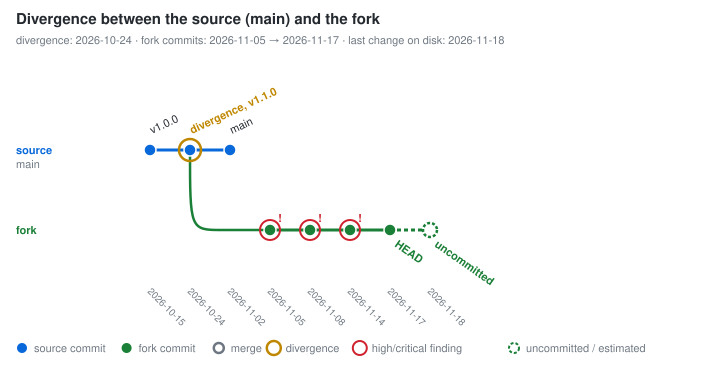

# ForkScope

Compare a **fork** with its **source** Git repository to prepare a security audit.
A vibecoded tool, because 2026.

Someone hands you "their version" of an open-source project. ForkScope works out which source commit it started from and what was changed. It also points out the changes worth a closer look: authentication, access control, cryptography, configuration, dependencies and secrets.



## TL;DR

```bash
cargo install --git https://github.com/shoxxdj/forkscope
forkscope --fork ./delivered-project --source https://github.com/org/project.git
```

The reports are written to `./forkscope-report/`.

## What you get

- **Source reference**: the source commit the fork is based on, with its branch and tag.
  - The result is exact when the fork has Git history.
  - Without history, or with rewritten history, it is an estimate with a confidence score and the reasons behind it.
- **Key dates**: when the fork diverged, its first and last commits, and the latest change on disk. A divergence graph shows the source line and the fork line, along with merges, uncommitted work and risky commits.
- **Changed files**: every file that was added, deleted, modified, renamed or moved, with line counts, SHA-256 hashes and a `.diff` file each.
- **Origin of each change**:
  - written by the fork;
  - uncommitted;
  - actually coming from the source (backport, cherry-pick);
  - rolled back to an older source version.
- **Fork history**: the fork's own commits, merges, rebases and cherry-picks, plus reverted source commits (detected by patch-id). It also reports source fixes the fork is missing.
- **Security leads**: 49 built-in rules applied to the added and removed lines of the diff (not just to file names). Examples:
  - an `if user.is_admin` check that was removed;
  - `verify=False`;
  - a disabled CSRF protection;
  - `--extra-index-url`;
  - `privileged: true`.
- **Dependencies**: added, removed and updated packages, and packages pulled from Git, a URL or a local path, for:
  - Cargo;
  - npm, yarn and pnpm;
  - pip, Poetry and pyproject;
  - Composer;
  - Maven and Gradle;
  - Go modules;
  - Bundler.
- **Secrets**: AWS, GitHub, GitLab, Stripe, Slack, private keys, passwords and generic tokens. Their values are always masked.

Findings are leads to investigate, not confirmed vulnerabilities.

## Usage

```bash
forkscope -f <fork-path> -s <source-url> [options]
```

| Option | Description |
|---|---|
| `-f, --fork` | Fork to analyse: a Git repository or a plain source directory |
| `-s, --source` | Git URL or local path of the original repository (HTTPS, SSH or private repositories through your Git credentials) |
| `-o, --output` | Output directory (default `./forkscope-report`) |
| `--branch` | Source branch to favour (default: the remote's default branch) |
| `--depth` | Shallow fetch of the source |
| `--full-diff` | Include full diffs in the Markdown and JSON reports |
| `--format` | `markdown`, `json` or `both` (default) |
| `--config` | TOML configuration file (see [`config.example.toml`](config.example.toml)) |
| `--force-snapshot` | Ignore the fork's Git history and estimate the reference from content |

Other commands:

```bash
forkscope info <path-or-url>   # quick repository information
forkscope rules                # list the active security rules
```

## Output

```
forkscope-report/
├── forkscope-report.md            # human-readable report
├── forkscope-report.json          # structured report (schema_version 1.0.0)
├── forkscope-report.schema.json   # JSON schema
├── divergence-graph.svg           # source / fork divergence graph
├── changed-files.txt / .csv       # list of changed files with their origin
└── diffs/                         # one unified diff per changed file
```

See [`examples/`](examples/) for a full report generated by `examples/demo.sh`.

## How it works

- **Fork with Git history**: the reference comes from Git ancestry (`rev-list --boundary`, `merge-base`), so it is exact.
- **No history, or rewritten history**: each source commit is scored by comparing Git blob hashes. The best candidates are then refined by content similarity. The result is always labelled as an estimate.
- **Comparison against the disk**: the diff compares the reference tree with what is actually on disk, uncommitted changes included. Renames are detected even without Git information.

## Safety

- **The fork is never modified, and no Git command runs inside it.** Its objects are fetched read-only into a temporary bare repository, so the fork's hooks, `fsmonitor` and filters are never triggered.
- **Nothing is executed, installed or sent anywhere.** Only `git` is used: no forge API.
- **Git never prompts for input.** Private repositories work through your credential helper or SSH agent.

## Limitations

- SHA-256 object-format repositories are not supported.
- Git LFS and `autocrlf` conversions can show up as modifications. Line-ending-only changes are flagged.
- The security rules are regular expressions: they produce leads, not proof. The `Analyzer` trait lets you plug in Semgrep or CodeQL.
- Commit messages are never trusted. Hints based on them, such as "missing security fixes", are labelled as hints.

## Development

```bash
cargo test          # unit and integration tests (real Git repositories)
./examples/demo.sh  # build a demo source + fork and run ForkScope on it
```

Requires Rust 1.88+ and `git` in `PATH`.

## License

MIT
