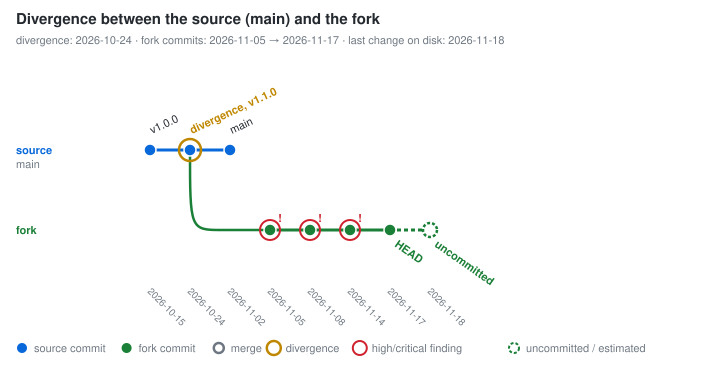

# ForkScope report

> Generated on 2026-11-18T10:36:31.448152291+01:00 by forkscope 0.1.0 (schema 1.0.0). The findings in this report are **leads to investigate**, not confirmed vulnerabilities.

## 1. Executive summary

- **Fork**: `/tmp/forkscope-demo/acme-api-fork` (Git repository with history linked to the source)
- **Source**: `/tmp/forkscope-demo/acme-api`
- **Source reference**: `58b860c7c7` (tag:v1.1.0) — identified with certainty (Git ancestry)
- **Fork-specific commits**: 4
- **Divergence**: 2026-10-24 09:36:30+00:00 (source commit `58b860c7c7`)
- **Fork modification period**: from 2026-11-05 09:36:30+00:00 to 2026-11-18 10:36:31+01:00
- **Files**: 3 added, 0 deleted, 4 modified, 0 renamed, 0 moved, 3 identical (+13 / −4 lines)
- **Files attributed to the fork**: 6 out of 7 differing files (see "Changed files", section 6)
- **Security findings**: Critical: 2 · High: 2 · Medium: 3 · Low: 3 · Info: 1
- **Dependencies**: 2 added, 0 removed, 0 versions changed, 0 sources changed, 1 external
- **Potential secrets**: 2

### Key dates

| Event | Date | Details |
|---|---|---|
| Fork divergence | **2026-10-24 09:36:30+00:00** | `58b860c7c7` endpoint health |
| First fork commit | **2026-11-05 09:36:30+00:00** | `53429a2c13` cleanup |
| Last fork commit | **2026-11-17 09:36:30+00:00** | `e45913ac5c` add rate limiting |
| Last file change (disk) | **2026-11-18 10:36:31+01:00** | `NOTES.txt` — file system date of 6 fork file(s), indicative (copying or extracting changes it) |
| Latest source commit (main) | **2026-11-02 09:36:30+00:00** | `694d63575f` security: disable redirects (CVE-2099-0001), rate limiting |
| Divergence duration | **25 day(s)** | between the divergence and the fork's latest known change |

### Divergence graph



<details><summary>Text version of the graph (newest at the top; S = source, F = fork)</summary>

```text
            S F
2026-11-18    ○             [fork] (uncommitted) 2 uncommitted modified file(s)
2026-11-17    ●  e45913ac5c [fork] (HEAD) add rate limiting
2026-11-14    ●  35d0acb788 [fork] configuration  ⚠ High
2026-11-08    ●  113a70cde7 [fork] corporate proxy  ⚠ Critical
2026-11-05    ●  53429a2c13 [fork] cleanup  ⚠ High
2026-11-02  ● │  694d63575f [source] (main) security: disable redirects (CVE-2099-0001), rate limiting
2026-10-24  ◆─╯  58b860c7c7 [source] (DIVERGENCE, v1.1.0) endpoint health
2026-10-15  ●    daebd987a5 [source] (v1.0.0) initial release
```

</details>

## 2. Repository information

| Item | Value |
|---|---|
| Fork path | `/tmp/forkscope-demo/acme-api-fork` |
| Type | Git repository with history linked to the source |
| Fork HEAD | `e45913ac5c7b326ef616279630c6c636c38a65ce` |
| HEAD reference | `refs/heads/main` |
| Shallow repository | no |
| Fork files analysed | 10 |
| Source URL | `/tmp/forkscope-demo/acme-api` |
| Source default branch | main |
| Preferred branch | main |
| Source branches / tags | 1 / 2 |
| Remotes declared by the fork | origin → `/tmp/forkscope-demo/acme-api` |
| Fork local branches | 1 |
| Fork tags | 2 (0 specific) |
| Stash entries | 0 |

## 3. Identified source reference

| Item | Value |
|---|---|
| Commit | `58b860c7c7f766702fd19e0a8525b2692a1470d0` |
| Method | Git ancestry (merge-base) |
| Commit date | 2026-10-24T09:36:30+00:00 |
| Author | Maintainer <Maintainer@example.org> |
| Message | endpoint health |
| Branches/tags pointing at this commit | tag:v1.1.0 |
| Source branches containing it | branch:main |
| Closest tag (describe) | `v1.1.0` |
| First tag containing this commit | `v1.1.0` |
| Initial starting point of the fork | `58b860c7c7` (2026-10-24T09:36:30+00:00) — endpoint health |

## 4. Confidence level

**100 % — certain (Git ancestry)**

Reasons:

- The fork's HEAD descends directly from source commit 58b860c7c7 (ancestry verified by Git: cryptographic commit IDs).
- 4 commit(s) present in the fork and absent from the source.

## 5. Fork-specific commit history

- Specific commits: **4** (0 merges)
- Source commits present in the fork history: 2
- Source commits integrated since the fork's starting point: 0
- Behind `main`: 1 source commit(s) not integrated

| Commit | Date | Author | Message | Files | +/− | Parents | Finding |
|---|---|---|---|---|---|---|---|
| `e45913ac5c` | 2026-11-17T09:36:30+00:00 | Contractor <Contractor@example.org> | add rate limiting | 1 | +5 / −0 | `35d0acb788` | — |
| `35d0acb788` | 2026-11-14T09:36:30+00:00 | Contractor <Contractor@example.org> | configuration | 1 | +3 / −0 | `113a70cde7` | **High** (Configuration, Secrets) |
| `113a70cde7` | 2026-11-08T09:36:30+00:00 | Contractor <Contractor@example.org> | corporate proxy | 2 | +3 / −1 | `53429a2c13` | **Critical** (Cryptography, Dependencies, Input validation) |
| `53429a2c13` | 2026-11-05T09:36:30+00:00 | Contractor <Contractor@example.org> | cleanup | 1 | +0 / −2 | `58b860c7c7` | **High** (Authorization, Other) |

### Suspicious commits

- **`35d0acb788`** configuration — Contractor <Contractor@example.org>
  - [High] Secrets: AWS access key ID (app/settings.py:2)
  - [High] Secrets: Credentials in a URL (app/settings.py:3)
  - [Medium] Configuration: Service exposure or debug mode (app/settings.py:1) [CONF-003]
  - [Low] Configuration: Sensitive configuration file modified (app/settings.py) [CONF-009]
- **`113a70cde7`** corporate proxy — Contractor <Contractor@example.org>
  - [Critical] Cryptography: TLS / certificate validation disabled (app/client.py:5) [CRYPTO-001]
  - [Medium] Dependencies: Package source modified (requirements.txt:4) [CONF-012]
  - [Low] Input validation: Request to a controllable URL (potential SSRF) (app/client.py:5) [INPUT-010]
  - [Low] Dependencies: dependency files modified: requirements.txt
- **`53429a2c13`** cleanup — Contractor <Contractor@example.org>
  - [High] Authorization: Role / permission check removed or modified (app/admin.py) [AUTHZ-001]
  - [Medium] Authorization: Access-denied response removed (app/admin.py) [AUTHZ-004]
  - [Medium] Other: innocuous commit message ("cleanup") for a sensitive change: commit messages are not reliable

### Uncommitted changes

- unstaged (modified): `app/auth.py`
- untracked: `NOTES.txt`

### Potentially missing source fixes

_Hint based on commit messages (not reliable)._

- `694d63575f` (2026-11-02T09:36:30+00:00) security: disable redirects (CVE-2099-0001), rate limiting

## 6. Global diff statistics

Comparison: reference `58b860c7c7` ↔ current fork content (including uncommitted changes).

| Metric | Value |
|---|---|
| Files (reference) | 7 |
| Files (fork) | 10 |
| Identical | 3 |
| Added | 3 |
| Deleted | 0 |
| Modified | 4 |
| Renamed | 0 |
| Moved | 0 |
| Binaries changed | 0 |
| Line endings only | 0 |
| Lines added | 13 |
| Lines removed | 4 |

### Origin of changes

A file that differs from the reference was not necessarily written by the fork: its content may be identical to another source version (backport, cherry-pick, rollback). The main criterion is content identity (Git blob) with the source history, then the fork commits.

| Origin | Files |
|---|---|
| fork | 4 |
| fork (uncommitted) | 2 |
| source (newer version) | 1 |

### Changed files

Full list also available in [`changed-files.txt`](changed-files.txt) and [`changed-files.csv`](changed-files.csv).

| Status | File | Origin | +/− | Fork commits | Diff |
|---|---|---|---|---|---|
| A added | `NOTES.txt` | fork (uncommitted) | +1 / −0 | — | [diff](diffs/NOTES.txt.diff) |
| M modified | `app/admin.py` | fork | +0 / −2 | `53429a2c13` | [diff](diffs/app/admin.py.diff) |
| M modified | `app/auth.py` | fork (uncommitted) | +1 / −1 | — | [diff](diffs/app/auth.py.diff) |
| M modified | `app/client.py` | fork | +1 / −1 | `113a70cde7` | [diff](diffs/app/client.py.diff) |
| A added | `app/settings.py` | fork | +3 / −0 | `35d0acb788` | [diff](diffs/app/settings.py.diff) |
| M modified | `requirements.txt` | fork | +2 / −0 | `113a70cde7` | [diff](diffs/requirements.txt.diff) |
| A added | `app/ratelimit.py` | source (newer version) (`694d63575f`) | +5 / −0 | `e45913ac5c` | [diff](diffs/app/ratelimit.py.diff) |

## 7. Added files

| File | Origin | Size | Lines | SHA-256 | Commits | Diff |
|---|---|---|---|---|---|---|
| `NOTES.txt` _(untracked)_ | fork (uncommitted) | 17 o | 1 | `90ea0c6d1cd4` | — | [diff](diffs/NOTES.txt.diff) |
| `app/ratelimit.py` | source (newer version) | 57 o | 5 | `3dc36a9c1bc7` | `e45913ac5c` | [diff](diffs/app/ratelimit.py.diff) |
| `app/settings.py` | fork | 124 o | 3 | `60bb0d7271b0` | `35d0acb788` | [diff](diffs/app/settings.py.diff) |

## 8. Deleted files

_None._

## 9. Modified files (including renamed and moved)

| File | Status | Origin | +/− | Similarity | SHA-256 before → after | Commits | Diff |
|---|---|---|---|---|---|---|---|
| `app/admin.py` | modified | fork | +0 / −2 | 75.0 % | `2244774a2b25` → `c0d7a0a58dfb` | `53429a2c13` | [diff](diffs/app/admin.py.diff) |
| `app/auth.py` | modified | fork (uncommitted) | +1 / −1 | 90.9 % | `5aff4c1cdb73` → `5b29e185a442` | — | [diff](diffs/app/auth.py.diff) |
| `app/client.py` | modified | fork | +1 / −1 | 80.0 % | `1f13a9e95c28` → `8e07540fd4bb` | `113a70cde7` | [diff](diffs/app/client.py.diff) |
| `requirements.txt` | modified | fork | +2 / −0 | 66.7 % | `0c45c3a0f42a` → `e75d1feaf762` | `113a70cde7` | [diff](diffs/requirements.txt.diff) |

## 10. Sensitive changes

| ID | Severity | Confidence | Category | File | Line | Change | Title |
|---|---|---|---|---|---|---|---|
| [F-0001](#f-0001) | Critical | high | Authentication | `app/auth.py` | 11 | added | JWT validation disabled or weakened |
| [F-0002](#f-0002) | Critical | high | Cryptography | `app/client.py` | 5 | added | TLS / certificate validation disabled |
| [F-0003](#f-0003) | High | medium | Authorization | `app/admin.py` | ref. 2 | removed | Role / permission check removed or modified |
| [F-0004](#f-0004) | High | medium | Dependencies | `requirements.txt` | — | added | Package source added/modified |
| [F-0005](#f-0005) | Medium | medium | Authentication | `app/auth.py` | 11 | modified | JWT verification removed or modified |
| [F-0006](#f-0006) | Medium | medium | Configuration | `app/settings.py` | 1 | added | Service exposure or debug mode |
| [F-0007](#f-0007) | Medium | low | Authorization | `app/admin.py` | ref. 3 | removed | Access-denied response removed |
| [F-0008](#f-0008) | Low | high | Dependencies | `requirements.txt` | — | added | Dependency added |
| [F-0009](#f-0009) | Low | medium | Configuration | `app/settings.py` | — | file | Sensitive configuration file modified |
| [F-0010](#f-0010) | Low | low | Input validation | `app/client.py` | 5 | added | Request to a controllable URL (potential SSRF) |
| [F-0011](#f-0011) | Info | low | Other | `app/auth.py` | — | file | Security-related file modified |

### F-0001

**JWT validation disabled or weakened** — Critical / confidence high — rule `AUTH-005` (builtin)

- File: `app/auth.py` (line 11)
- Change: added
- Commits: none (uncommitted change or untracked file)
- Diff: [diffs/app/auth.py.diff](diffs/app/auth.py.diff)
- Justification: JWT signature or expiry verification seems disabled.

Old code:

````
    return jwt.decode(token, key, algorithms=["HS256"])
````

New code:

````
    return jwt.decode(token, key, algorithms=["HS256", "none"])
````

### F-0002

**TLS / certificate validation disabled** — Critical / confidence high — rule `CRYPTO-001` (builtin)

- File: `app/client.py` (line 5)
- Change: added
- Commits: `113a70cde7`
- Diff: [diffs/app/client.py.diff](diffs/app/client.py.diff)
- Justification: TLS certificate verification seems disabled: interception (MITM) possible.

Old code:

````
    return requests.get(url, timeout=5).json()
````

New code:

````
    return requests.get(url, timeout=5, verify=False).json()
````

### F-0003

**Role / permission check removed or modified** — High / confidence medium — rule `AUTHZ-001` (builtin)

- File: `app/admin.py` (line 2 of the reference)
- Change: removed
- Commits: `53429a2c13`
- Diff: [diffs/app/admin.py.diff](diffs/app/admin.py.diff)
- Justification: A role/permission-based access control was removed or modified.

Old code:

````
    if not request.user.is_admin:
````

### F-0004

**Package source added/modified** — High / confidence medium — rule `DEP` (dependencies)

- File: `requirements.txt`
- Change: added
- Commits: `113a70cde7`
- Diff: [diffs/requirements.txt.diff](diffs/requirements.txt.diff)
- Justification: A dependency download source was added or modified: risk of dependency confusion or malicious registry.

New code:

````
option:--extra-index-url https://pypi.acme-mirror.example/simple (https://pypi.acme-mirror.example/simple)
````

### F-0005

**JWT verification removed or modified** — Medium / confidence medium — rule `AUTH-006` (builtin)

- File: `app/auth.py` (line 11)
- Change: modified
- Commits: none (uncommitted change or untracked file)
- Diff: [diffs/app/auth.py.diff](diffs/app/auth.py.diff)
- Justification: The token validation mechanism was modified: check signature, algorithm, audience and expiry. The condition was modified while keeping the control element: check that it has not become less restrictive.

Old code:

````
    return jwt.decode(token, key, algorithms=["HS256"])
````

New code:

````
    return jwt.decode(token, key, algorithms=["HS256", "none"])
````

### F-0006

**Service exposure or debug mode** — Medium / confidence medium — rule `CONF-003` (builtin)

- File: `app/settings.py` (line 1)
- Change: added
- Commits: `35d0acb788`
- Diff: [diffs/app/settings.py.diff](diffs/app/settings.py.diff)
- Justification: A service is exposed on all interfaces or a debug mode is enabled.

New code:

````
DEBUG = True
````

### F-0007

**Access-denied response removed** — Medium / confidence low — rule `AUTHZ-004` (builtin)

- File: `app/admin.py` (line 3 of the reference)
- Change: removed
- Commits: `53429a2c13`
- Diff: [diffs/app/admin.py.diff](diffs/app/admin.py.diff)
- Justification: A branch returning an access-denied error was removed.

Old code:

````
        return forbidden()
````

### F-0008

**Dependency added** — Low / confidence high — rule `DEP` (dependencies)

- File: `requirements.txt`
- Change: added
- Commits: `113a70cde7`
- Diff: [diffs/requirements.txt.diff](diffs/requirements.txt.diff)
- Justification: New dependency `acme-internal-utils`: check its legitimacy (typosquatting, maintenance, vulnerabilities).

New code:

````
acme-internal-utils ==0.1.0
````

### F-0009

**Sensitive configuration file modified** — Low / confidence medium — rule `CONF-009` (builtin)

- File: `app/settings.py`
- Change: file
- Commits: `35d0acb788`
- Diff: [diffs/app/settings.py.diff](diffs/app/settings.py.diff)
- Justification: A configuration file with security impact was modified. — file added (+3 / -0 lines)

### F-0010

**Request to a controllable URL (potential SSRF)** — Low / confidence low — rule `INPUT-010` (builtin)

- File: `app/client.py` (line 5)
- Change: added
- Commits: `113a70cde7`
- Diff: [diffs/app/client.py.diff](diffs/app/client.py.diff)
- Justification: An outgoing request uses a dynamic URL: check that it is not user-controlled.

Old code:

````
    return requests.get(url, timeout=5).json()
````

New code:

````
    return requests.get(url, timeout=5, verify=False).json()
````

_1 Info-level finding(s) listed only in the table above._

## 11. Dependency analysis

### `requirements.txt` (Python, manifest, file modified)

| Dependency | Scope | Change | Before | After | External |
|---|---|---|---|---|---|
| `acme-internal-utils` | dependencies | added | — | `==0.1.0` | no |
| `option:--extra-index-url` | pip-option | added | — | `https://pypi.acme-mirror.example/simple` | ⚠️ yes |

## 12. Potential secrets

_Values are masked. Test and example files are not considered safe._

| ID | Severity | Confidence | Type | File | Line | Masked value | Test/example | Commits |
|---|---|---|---|---|---|---|---|---|
| S-0001 | High | high | AWS access key ID | `app/settings.py` | 2 | `AKIA********** (20 car.)` | no | `35d0acb788` |
| S-0002 | High | high | Credentials in a URL | `app/settings.py` | 3 | `Sup3********** (11 car.)` | no | `35d0acb788` |

## 13. Investigation recommendations

1. Review first the 2 critical and 2 high finding(s) in the "Sensitive changes" section: they are leads, to be confirmed by reading the code.
2. 2 potential secret(s) introduced: check their validity, revoke/rotate them if needed, and check the Git history (a deleted secret remains in the commits).
3. 1 external dependency(ies) (Git/URL/path) and 0 source change(s): check the origin and integrity of these packages.
4. 2 dependency(ies) added: check their legitimacy (typosquatting, dependency confusion) and their known vulnerabilities with a dedicated tool (cargo audit, npm audit, pip-audit…).
5. The working tree contains uncommitted changes (0 staged, 1 unstaged) and 1 untracked file(s): these are not in the fork's history.
6. 1 source commit(s) newer than the reference mention security in their message: check whether these fixes are missing from the fork (hint based on messages, not reliable).
7. The fork is 1 commit(s) behind source branch "main".
8. 3 fork commit(s) contain high or critical severity changes: review them commit by commit.
9. 1 file(s) differing from the reference actually come from the source (backport, cherry-pick): the review effort can focus on the 6 file(s) attributed to the fork.

---
_Report generated by ForkScope. No data was sent to any external service; the fork's code was not executed._
